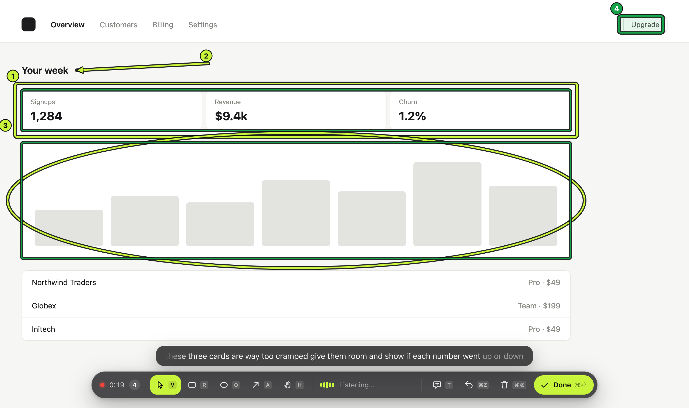
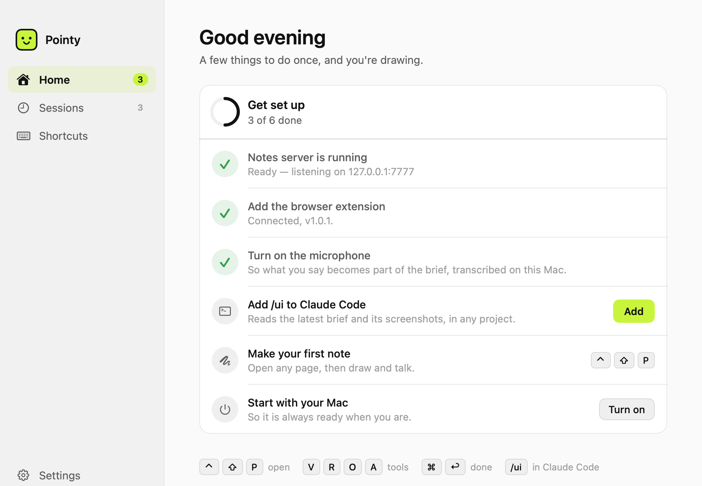
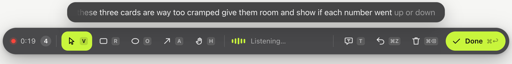
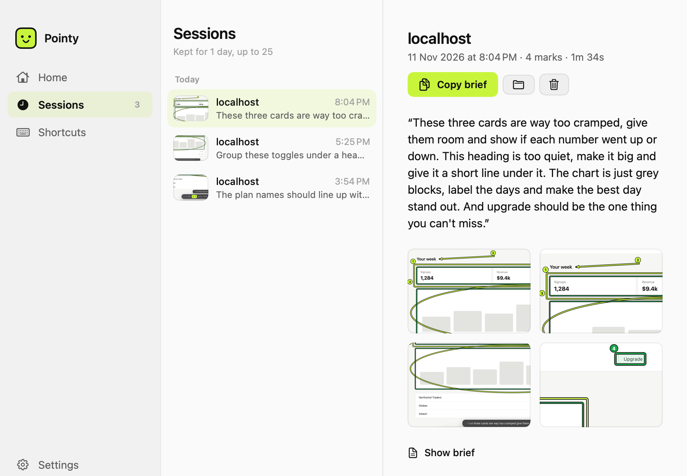
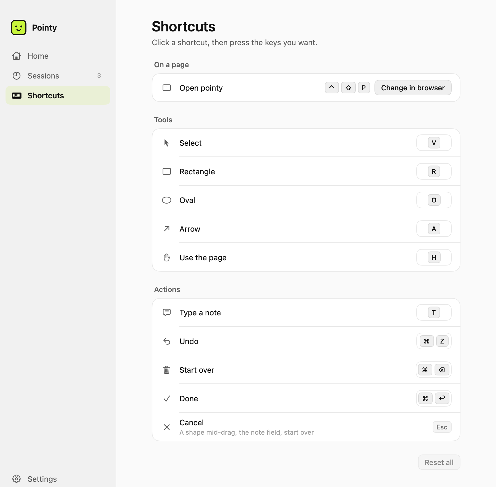
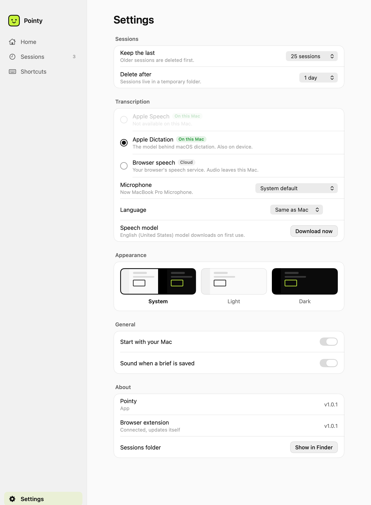

<p align="center">
  
</p>

<h1 align="center">pointy</h1>

<p align="center">Draw on a web page, say what you want changed, and get a note your coding agent can act on.</p>

<p align="center">
  <a href="https://github.com/HamzaBinMubeen/pointy/releases/latest/download/Pointy.dmg"><b>Download for Mac</b></a> ·
  <a href="https://hamzabinmubeen.github.io/pointy/">Website</a> ·
  <a href="SAMPLE-BRIEF.md">Example output</a>
</p>



## What it does

Telling an AI agent which part of your UI to change is slow. You end up describing
things like "the second card in the row under the heading".

With Pointy you open your page, draw on the parts you mean, and talk. When you press
Done, Pointy writes a short note (we call it a *brief*) that lists:

- what you said, matched to each thing you drew
- the exact elements you marked, by their component name, with the file and line
  they come from
- how they are laid out right now (for example "3 columns, 6px gap")
- a cropped screenshot of each mark

The brief is copied to your clipboard. Paste it into Claude Code, Cursor, Codex or any
other agent. In Claude Code you can also type `/ui`.

Pointy is a small Mac app plus a browser extension for Chrome, Edge or Brave. Everything
runs on your Mac.

## Install

1. [Download Pointy.dmg](https://github.com/HamzaBinMubeen/pointy/releases/latest/download/Pointy.dmg)
   and drag Pointy into Applications.
2. Open Pointy. macOS will block it the first time because it isn't notarised yet. Go to
   **System Settings › Privacy & Security**, scroll down, and click **Open Anyway**. You
   only do this once.
3. Pointy shows a short checklist. Work through it:
   - **Add the browser extension.** Pointy opens your browser's extensions page and
     copies a folder path for you. Turn on **Developer mode**, click **Load unpacked**,
     press **⌘⇧G**, paste, and press Return. After this, Pointy keeps the extension up
     to date on its own.
   - **Turn on the microphone.**
   - **Add `/ui` to Claude Code** (one click).
   - **Make your first note.**
   - **Start with your Mac** (optional).



You need macOS 14 or later. Speech is turned into text on your Mac on macOS 26. On
older versions Pointy uses your browser's speech recognition instead.

## How to use it

1. Open the page you are working on. This can be your local dev server or any website.
2. Press **⌃⇧P** (Control + Shift + P). A toolbar appears at the bottom of the page and
   Pointy starts listening.
3. Draw on the page and say what you want. Your words appear above the toolbar as you
   speak.
4. Press **⌘↩** (Command + Return) or click **Done**. The brief is now on your
   clipboard.
5. Paste it into your agent, or type `/ui` in Claude Code.



### Tools

| Key | Tool | What it does |
|---|---|---|
| **V** | Select | Click one element to talk about it. |
| **R** | Rectangle | Selects everything fully inside the box. |
| **O** | Oval | Same as the rectangle, as an oval. |
| **A** | Arrow | Points at something, or from one thing to another ("move this there"). |
| **H** | Use the page | Lets you click and scroll the page normally. Press again to go back to drawing. |
| **T** | Type a note | Type instead of talking, for the latest mark. |
| **⌘Z** | Undo | Removes the latest mark. |
| **⌘⌫** | Start over | Throws the session away. Asks first. |
| **⌘↩** | Done | Saves and copies the brief. |
| **Esc** | Cancel | Cancels what you are in the middle of. It never saves. |

Tips:

- Before you draw, Pointy outlines the element under your cursor and shows its name.
  Hold **Shift** to pick its parent instead.
- Your marks are lime. The elements they selected are outlined in green, so you can
  check the right things were picked.
- Click a mark's number to delete just that mark.
- You can talk the whole time. Marks drawn within a few seconds of each other count as
  one instruction.
- You can move to another page in the middle of a session. Your marks stay.

## See past sessions

The **Sessions** tab lists every session you have kept, with what you said and the
screenshots. Use **Copy brief** if your clipboard got overwritten.



Sessions are saved in `~/Library/Application Support/Pointy/Sessions`. By default Pointy
keeps the last 25 for one day. You can change both in Settings.

Each session folder has:

| File | What it is |
|---|---|
| `BRIEF.md` | The brief. This is what you give your agent. |
| `NN-crop.png` | A cropped screenshot of each mark. |
| `NN.jpg` | The full screen for each mark. |
| `notes.json` | All the raw data. |

[SAMPLE-BRIEF.md](SAMPLE-BRIEF.md) shows what a brief looks like.

## Change the keys

Every key except Esc can be changed in the **Shortcuts** tab. Click a key, then press
the new one. If another action already uses it, Pointy tells you.



The open shortcut (⌃⇧P) belongs to your browser. Change it at
`chrome://extensions/shortcuts` or `edge://extensions/shortcuts`.

## Settings



Here you choose how long to keep sessions, which speech engine to use, your microphone
and language, light or dark mode, and whether Pointy starts with your Mac.

## Privacy

- Nothing is uploaded. The extension only talks to the Pointy app on your Mac
  (`127.0.0.1:7777`).
- The app only answers the extension. Websites you visit can't reach it.
- With **Apple Speech** or **Apple Dictation**, your voice is turned into text on your
  Mac. **Browser speech** sends audio to your browser's speech service (Google, in
  Chrome). It is only used if you pick it, or on macOS older than 26.
- Screenshots are only taken of the tab you are marking up, while a session is open.
- No accounts and no analytics. The only download is the speech model macOS fetches the
  first time you use on-device speech.

## Things to know

- **Component names only show up in development builds.** On a live production site,
  you get the element's tag and text instead, for example `h2` "Your week". That is
  usually still enough for an agent to find it.
- **File and line numbers are best effort.** They work in most React dev setups. When
  they don't, the brief includes a search hint instead.
- **A rectangle only selects things that fit fully inside it.** Draw a little wider than
  you need.
- **Pointy starts by itself** on `localhost`, `127.0.0.1` and `*.localhost`. On other
  sites, press ⌃⇧P or click the extension's icon.

## Build from source

You need Xcode 26.

```bash
scripts/build-app.sh --install   # build and install to /Applications
scripts/make-dmg.sh              # make build/Pointy-<version>.dmg
```

- The build signs with your Apple Development certificate if you have one (free: add
  your Apple ID in Xcode › Settings › Accounts). This keeps the microphone permission
  between builds.
- The app and the extension share one version number, set in `extension/manifest.json`.
- The website is in `site/` and is published to GitHub Pages when `main` changes.
- Without the Mac app (for example on Linux), `node server/server.mjs` runs the same
  local server. It needs Node 18 or later.

<details>
<summary>How it works</summary>

```
browser tab
 ├── app.js       the toolbar and drawing, reads the page and React's component names
 └── bridge.js    passes messages between the page and the extension
        │
   background.js  keeps the session, takes screenshots, sends it all on Done
        │
   Pointy.app     127.0.0.1:7777: turns speech into text, saves the session,
                  writes BRIEF.md (using server/brief.cjs)
```

`app.js` runs inside the page itself because that is the only place it can read
React's component names. Code running there can't use the extension's APIs, so
`bridge.js` passes messages back and forth.

</details>

## Contributing

Issues and pull requests are welcome. For a bigger change, open an issue first.

To report a security problem, see [SECURITY.md](.github/SECURITY.md).

## Licence

[MIT](LICENSE) © 2026 Hamza Bin Mubeen. If Pointy saves you time,
[buy me a coffee](https://buymeacoffee.com/hamzabinmubeen).
